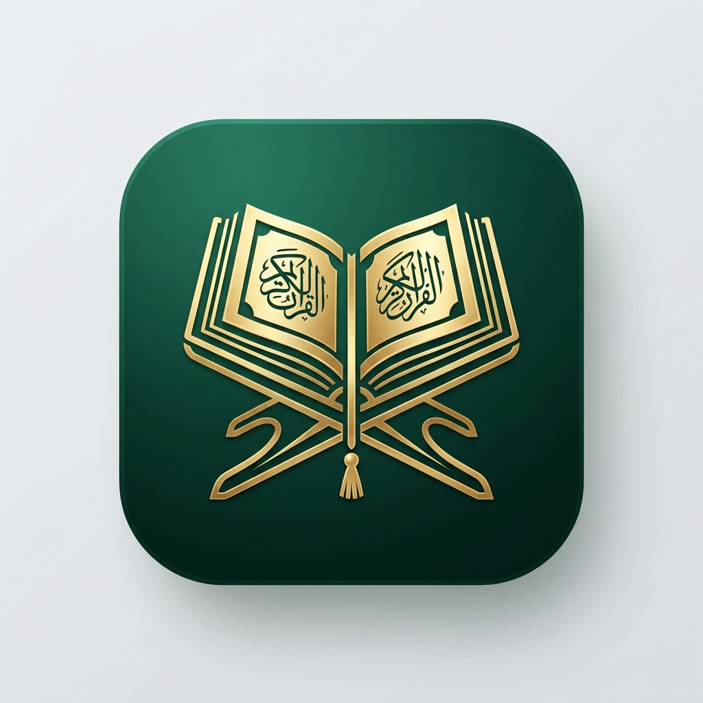

# Ayat - Premium Islamic Lifestyle & Worship Companion

<div align="center">
  
  <br />
  <h3>Spiritual reflection, Quran study, and daily worship — beautifully designed.</h3>
  <p>Built with <strong>React Native</strong>, <strong>Expo SDK 54</strong>, and the <strong>New Architecture</strong>.</p>
</div>

---

## 🌟 Overview

**Ayat** is an all-in-one, modern Islamic lifestyle and worship companion application designed for Muslims worldwide. Inspired by timeless Islamic geometry, classical calligraphy, and an elegant **Emerald & Gold** palette, Ayat delivers a fast, offline-first, and spiritually enriching experience for daily worship, Quranic study, prayer tracking, and spiritual growth.

---

## ✨ Features & Capabilities

### 📖 Interactive Quran Reader
- **Authentic Uthmani Script**: Clear, beautifully rendered Arabic typography with adjustable font sizes.
- **Side-by-Side Translations & Transliteration**: Multiple English translations and phonetic transliteration for every verse.
- **Audio Recitation**: Verse-by-verse recitation streaming with active highlighting and playback speed controls.
- **Smart Verse Search**: Instant Arabic, English translation, and transliteration search across the entire Quran.
- **Bookmarks & Notes**: Easily save and revisit favorite verses and reflections.

### 🕌 Prayer Times & Spiritual Analytics
- **Precise GPS Prayer Times**: Automated calculation of Fajr, Dhuhr, Asr, Maghrib, and Isha based on local coordinates.
- **Prayer Log & 2-Day History**: Log prayer completions with support for retroactive check-ins up to 2 days prior.
- **Streak & Monthly Heatmap**: Track prayer consistency with visual streak counters and monthly completion analytics.

### 🐾 Prayer Pause — Meet Uzza the Cat (Screen Time for Muslims)
- **Interactive Cat Companion**: Uzza's mood and vitality react directly to your daily Salah completions and screen time habits.
- **6 Dynamic Emotional States**: *Thriving, Content, Tired, Struggling, Exhausted,* and *Collapsed*.
- **Salah Focus Mode**: Automatically locks distracting apps (Instagram, TikTok, YouTube, etc.) 15 minutes before and after prayer times.
- **Proof Mode ("Pray to Unlock")**: Complete your prayer and scan your prayer mat to unlock apps, or confirm with Honor Mode.
- **Brick Mode**: Maximum digital detox for deep worship and Quran recitation.

### 🤝 Charity & Sadaqah Hub
- **Vetted Islamic Causes**: Verified campaigns for Gaza Emergency Relief, Clean Water Wells (Sadaqah Jariyah), Orphan Sponsorship, Food Rations, and Mosque Construction.
- **Interactive Donation Flow**: Preset amounts and custom giving with currency support, anonymous donation options, and personal Du'a/intention notes.
- **Giving History & Impact Summary**: Local SQLite tracking of total donations, causes supported, and instant official receipt generation.
- **Admin Email Dispatch**: Every donation is asynchronously recorded and dispatched to the administrator.

### 📿 Smart Digital Tasbih
- **Interactive Counter**: Touch-anywhere digital beads with realistic haptic vibration and sound effects.
- **Multiple Built-in Dhikr**: SubhanAllah, Alhamdulillah, Allahu Akbar, Astaghfirullah, and custom phrases.
- **Target Counter & Reset**: Set custom goals (33, 99, 100, 1000) with milestone vibrations and session logs.

### 📚 Islamic Stories & Prophet Biographies
- **Rich Story Library**: Comprehensive collection covering the Lives of the Prophets, Sahabah, and pivotal moments in Islamic history.
- **Live Search & Category Filter**: Filter stories by category (Prophets, Quranic Events, Sahabah, History) or search keywords in real time.
- **Distraction-Free Reading**: Immersive reader layout optimized for comfortable long-form reading.

### 🤲 Daily Adhkar & Duas
- **Categorized Supplications**: Morning & Evening Adhkar, post-prayer dhikr, travel duas, and protection prayers with Arabic, transliterations, and references.

### ✨ 99 Names of Allah (Asma ul-Husna)
- **Beautiful Name Cards**: Explore the 99 attributes of Allah with Arabic calligraphy, English meanings, and spiritual explanations.

### 📅 Hijri Calendar & Islamic Events
- **Dual Calendar View**: Synchronized Hijri and Gregorian dates highlighting significant Islamic events (Ramadan, Eid, Ashura, Laylatul Qadr).

### 🎧 Customer Care & User Support
- **Direct Support Inquiries**: Users can submit their phone number, issue description, and topic category directly through the in-app Customer Care screen.
- **Automated Diagnostics**: Every inquiry is automatically dispatched to `mohammed16armaan@gmail.com` with the user's phone number, details, device brand/model, OS version, and timestamp.

### 🔐 Security & Personalization
- **Biometric Authentication**: Fingerprint and FaceID biometric unlock for privacy and data protection.
- **Local SQLite Engine**: All user records, bookmarks, prayer histories, and preferences stay on your device offline.
- **Multi-Theme Support**: Emerald Dark, Clean Light, and Sepia reading themes.

---

## 🛠️ Architecture & Tech Stack

| Component | Technology |
|---|---|
| **Framework** | [React Native 0.81.5](https://reactnative.dev/) via [Expo SDK 54](https://expo.dev/) |
| **Architecture** | **New Architecture** enabled (TurboModules + Fabric) |
| **Navigation** | [Expo Router v6](https://docs.expo.dev/router/introduction/) (File-based navigation) |
| **Database** | [Expo SQLite](https://docs.expo.dev/versions/latest/sdk/sqlite/) (Local, offline-first) |
| **Audio Engine** | [Expo AV](https://docs.expo.dev/versions/latest/sdk/av/) (Background playback capable) |
| **Biometrics** | [Expo Local Authentication](https://docs.expo.dev/versions/latest/sdk/local-authentication/) |
| **Animations** | [React Native Reanimated](https://docs.swmansion.com/react-native-reanimated/) & [Worklets](https://github.com/software-mansion/react-native-worklets) |
| **Icons & UI** | [Lucide React Native](https://lucide.dev/) & [Expo Vector Icons](https://icons.expo.fyi/) |
| **Language** | TypeScript with strict type checking |

---

## 🚀 Getting Started

### Prerequisites
- [Node.js](https://nodejs.org/) (v18 or later)
- Android Studio / Android SDK (with `ANDROID_HOME` configured)
- Physical Android device (USB Debugging enabled) or Android Emulator

### Installation

1. **Clone the repository**:
   ```bash
   git clone https://github.com/MohammedArmaan-ui/Ayat.git
   cd Ayat
   ```

2. **Install dependencies**:
   ```bash
   npm install
   ```

3. **Configure local Android SDK** (if running natively):
   Ensure `android/local.properties` exists with your SDK path:
   ```properties
   sdk.dir=C\:\\Users\\<USER>\\AppData\\Local\\Android\\Sdk
   ```

4. **Start the Metro development server**:
   ```bash
   npx expo start -c
   ```

5. **Run on Android**:
   ```bash
   npx expo run:android
   ```
   Or connect your physical device via USB and forward the Metro port:
   ```bash
   adb reverse tcp:8081 tcp:8081
   ```

---

## 📁 Project Structure

```text
Ayat/
├── app/                      # Expo Router screens and navigation flows
│   ├── (tabs)/               # Bottom tab navigation (Home, Reader, Prayer, Stories, Tools)
│   │   ├── bookmarks.tsx     # Bookmarked Ayahs & reflections
│   │   ├── prayer.tsx        # Prayer times, tracker, streak & monthly heatmap
│   │   ├── reader.tsx        # Quran reader screen with audio player
│   │   ├── stories.tsx       # Islamic stories with search & filters
│   │   ├── tasbih.tsx        # Interactive digital dhikr counter
│   │   └── tools.tsx         # Islamic utilities & tools directory
│   ├── adhkar.tsx            # Daily Adhkar and supplications
│   ├── calendar.tsx          # Hijri / Gregorian Islamic calendar
│   ├── charity.tsx           # Charity & Sadaqah Hub
│   ├── customer-care.tsx     # Customer Care & User Support inquiry screen
│   ├── names-of-allah.tsx    # 99 Names of Allah browser
│   ├── prayer-pause.tsx      # Screen Time for Muslims (featuring Uzza the cat)
│   ├── search.tsx            # Full Quran verse search
│   └── _layout.tsx           # Root navigation, theme & database initializer
├── assets/                   # Fonts, icons, images, and brand assets
├── src/
│   ├── components/           # Reusable UI widgets (UzzaCat, AyahCard, AudioController, Splash, etc.)
│   ├── constants/            # Curated data (Stories, Names of Allah, Adhkar, Surah metadata)
│   ├── database/             # SQLite schema, migrations, and lazy connection handlers
│   ├── services/             # Core services (Auth, Audio, Prayer, Quran, Settings, PrayerPause, Notification)
│   └── theme/                # Emerald & Gold color palettes, typography, and styling
└── android/                  # Native Android project configuration (Gradle 8.14, Kotlin 2.1)
```

---

## 📄 License & Etiquette

This project is built for spiritual reflection and educational benefit. When contributing or utilizing Quranic texts, please ensure translations, Arabic scripts, and recitation assets are treated with utmost reverence.

---

<div align="center">
  Crafted with care and devotion by <strong>Mohammed Armaan</strong> 🌙
</div>